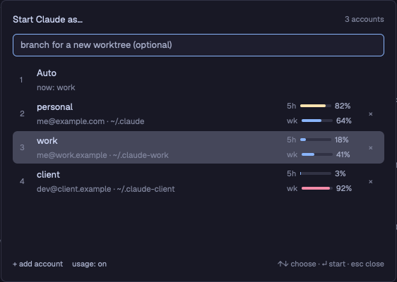

# Claude Accounts

A dialog that starts Claude Code on the account you choose. Use it when you
have more than one Claude subscription, for example a personal one and a work
one. Each account shows its email and, if you turn it on, its 5-hour and
weekly usage. **Auto** picks the account with the most headroom. Type a branch
name first, and Claude starts in a new git worktree instead of a new tab. Each
account also shows up in Herdr's own agent menus as "Claude (<name>)".

## What you see

- **The dialog** opens in the center of the window, 560 × 400 px, with
  `⌘⇧A` (`mod.open:claude-accounts`). It has 16 px of padding, a 10 px gap
  between parts, the theme's `popover` color behind it, and 13 px text.
- **Title row.** "Start Claude as…" in semibold `foreground` on the left.
  "<n> accounts" in 11 px `dim` text on the right.
- **Input**, 32 px tall, 6 px corners, `background` color, with a 1 px
  border: `accent` while it has the keyboard, `input` when it does not. Its
  placeholder reads "branch for a new worktree (optional)".
- **Account list**, one 46 px row per account, 7 px corners, a 2 px gap:
  - On the left, `⌘1` to `⌘9` in 11 px `dim` text, in a 22 px column.
  - Then the account name in `foreground`, and under it 11.5 px `dim` text:
    "<email> · <config folder>", or "not logged in yet · <folder>".
  - With usage on, two meters on the right, one above the other: "5h" and
    "wk". Each meter has a 44 × 4 px bar on `raised` with 2 px corners, then
    the percent in `muted`. The bar is `done` below 70 %, `ansi3` (yellow)
    from 70 %, and `blocked` from 90 %. Its tooltip reads "resets in 2h".
    "…" shows while the usage loads. "not logged in" or "usage <status>"
    shows when it cannot load.
  - A "×" at the far right. After one click it reads "remove?" in
    `blocked`.
  - The selected row is `selected`; other rows show `hover` under the
    pointer.
  - With usage on and more than one account, the first row is **Auto**, with
    "now: <name>" under it, and no meters or "×".
- **Footer**, 11 px: "+ add account" and "usage: on|off" as `muted` links
  (`foreground` on hover) on the left. On the right, in `dim`:
  "↑↓ choose · ↵ or ⌘1–9 start · esc close", or "starting…".
- **Add mode.** The title reads "Add a Claude account". A `muted` line says
  "Makes ~/.claude-<name> and starts Claude Code there, so you can log in."
  The input asks for "account name, e.g. work". The list goes away, and the
  first footer link reads "back".

## How it behaves

- **Start.** ↵, a click on a row, or `⌘<n>` starts Claude on that account.
  The dialog closes. With the branch input empty, Claude starts in a new tab
  of the selected space, named "claude (<name>)", in the focused terminal's
  folder.
- **New worktree.** With a branch name typed, the mod opens Herdr's own
  `worktree` dialog with `{ space, branch, argv }`. That dialog makes the
  checkout in `~/.herdr/worktrees/<repo>/<branch>` and a space whose first
  tab runs Claude. If the folder is not in a git repository, a toast says so.
- **Setup per repo.** `accounts.json` can hold `"setup": { "<repo>":
  "<command>" }`. For a new worktree of that repo, the command runs first
  (`<command> && claude …`). The repo is the main checkout's folder name.
- **Auto** starts the account with the lowest `max(5h %, week %)`. With no
  usage loaded yet, an error says "No usage yet to choose from. Pick an
  account."
- **The last account** you started is selected when the dialog opens.
- **Add account.** Type a name and press ↵. The mod makes `~/.claude-<name>`
  (the name is lowercased, other characters become "-"), saves the list, and
  opens a tab named "claude login (<name>)" that runs Claude Code with that
  folder. A new folder has no login, so Claude Code starts its login.
- **Remove.** Two clicks on "×" take the account off the list and out of
  `programs.json`. Its folder and its login stay.
- **Usage on/off** saves at once. Usage is off on a new install.
- When Claude exits, the terminal stays open in your login shell, like
  Herdr's own agent launcher leaves it.
- Esc closes the dialog. ↑ and ↓ move through the rows from the input too.

## Built from

- `mods/claude-accounts/`:
  - `mod.json`: `{ "place": "none", "title": "Claude Accounts", "overlay": {
    "kind": "dialog", "width": 560, "height": 400 } }`.
  - `main.js`: the dialog. A `View` with two `InputState`s (branch and
    account name). It uses `gpui-base` (`v_flex`, `h_flex`, `Input`) and
    `herdr` (`run`, `props`, `closeOverlay`, `openOverlay`, `theme`,
    `focused`, `notify`).
  - `accounts.js`: no UI. It loads and saves the list, reads emails and
    usage, and builds the command.
- **The list** is `~/.config/herdr-app/data/claude-accounts/accounts.json`:
  `{ "usage": false, "accounts": [{ "name", "dir" }], "setup": {}, "last" }`.
  When the file is missing, the mod makes it from `~/.claude` (named "main",
  if `~/.claude.json` exists) and each `~/.claude-*` folder that holds a
  `.claude.json` (named after the suffix).
- **programs.json.** Each saved change writes one entry per account that is
  not `~/.claude`, under the key `claude@<name>`: `{ "name": "Claude
  (<name>)", "icon": "icons/claude.svg", "run": ["env",
  "CLAUDE_CONFIG_DIR=<absolute dir>", "claude"] }`. The mod keeps all other
  keys as they are. `~/.claude` is Herdr's built-in `claude`.
- **Email**: `oauthAccount.emailAddress` in `~/.claude.json` for the default
  account, or in `<dir>/.claude.json` for the others.
- **Usage**: `GET https://api.anthropic.com/api/oauth/usage` with
  `Authorization: Bearer <token>` and `anthropic-beta: oauth-2025-04-20`. It
  reads `five_hour` and `seven_day`, each `{ utilization, resets_at }`. The
  token is `claudeAiOauth.accessToken`:
  - macOS: `security find-generic-password -s <service> -w`. The service is
    `Claude Code-credentials` for `~/.claude`, and
    `Claude Code-credentials-<first 8 hex of sha256(absolute dir)>` for the
    others.
  - Linux, or when the Keychain has none: `<dir>/.credentials.json`.
- **The command** (`argv`): `[$SHELL, "-lc", "<setup> && env
  CLAUDE_CONFIG_DIR='<dir>' claude; exec '<$SHELL>' -l"]`. The `env` part is
  left out for `~/.claude`, and the setup part when there is none. A tab:
  `run("tab.new", { name, argv })`. A worktree: `openOverlay({ mod:
  "worktree", kind: "dialog", width: 440, height: 260, props: { space,
  branch, argv } })`.
- `keys.json` snippet: `"global": { "cmd-shift-a": "mod.open:claude-accounts" }`.

## Watch out

- **The usage endpoint is not documented.** Anthropic can change or remove
  it. The mod then shows "usage <status>", and everything else still works.
- **The mod reads your login token** to get usage, and sends it only to
  `api.anthropic.com`. That is why usage is off until you turn it on.
- `InputState` has no `set_placeholder` and no `is_focused`. Use one input
  per mode, and follow focus with its `focus` and `blur` events.
- `writeTextFile` needs the text that is in the file now as `expected` (or
  `null` for a new file). Read the file just before you write it.
- The worktree dialog asks git for the repo again, so the mod passes
  `space`, not a folder. The space is `focused().space`.
- A new-worktree space starts with Claude, not a shell. A tool that types
  into the first shell of a new worktree (such as a watcher on `hc events`)
  now types into Claude. Turn such a tool off.
- Editing `keys.json` makes Herdr treat the file as yours: later default
  shortcuts are not added on upgrade.
- macOS and Linux only. The command uses `sh`, `env` and `$SHELL`.

## Done when

1. `herdr-app check mods/claude-accounts` passes, and `herdr-app status`
   shows `"errors": []`.
2. `⌘⇧A` opens the dialog. With no `accounts.json`, it lists `~/.claude` as
   "main" and each `~/.claude-*` folder that Claude Code has used.
3. `programs.json` then has a `claude@<name>` entry for each account that is
   not `~/.claude`, and Herdr's agent menu shows "Claude (<name>)".
4. "usage: off" → "usage: on" shows meters for each logged-in account within
   a few seconds, and an Auto row whose "now:" names the lowest
   `max(5h, week)`.
5. ↵ on an account opens a tab "claude (<name>)". In it, `/status` in
   Claude shows that account's email.
6. Type `try-it`, then ↵: a space opens on `~/.herdr/worktrees/<repo>/try-it`
   with Claude on the chosen account.
7. "+ add account", `test`, ↵ makes `~/.claude-test` and opens "claude login
   (test)" at Claude Code's login screen.
8. Two clicks on "×" next to `test` take it off the list and out of
   `programs.json`, and `~/.claude-test` is still there.
